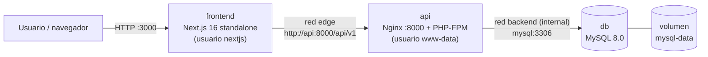

# E-commerce contenerizado: Next.js + Laravel + MySQL

Entorno de produccion completo para un e-commerce, orquestado con Docker Compose.
El objetivo es demostrar tecnicas avanzadas de contenerizacion: **multi-stage
builds**, cache de capas, imagenes minimas, usuario no-root, configuracion
explicita y una red interna que no expone la base de datos.

El proyecto parte de dos aplicaciones ya desarrolladas durante el bootcamp:

- **Frontend:** Next.js 16 (App Router) + React 19 + Tailwind 4.
- **Backend:** Laravel 12 (API REST con JWT, Stripe y Swagger/OpenAPI).
- **Base de datos:** MySQL 8.0.

---

## Arquitectura de contenedores



```text
Host
 |-- :3000 -----------------------> frontend (Next.js standalone)
 |                                    |
 |                                    +-- red `edge` --> api:8000
 |-- 127.0.0.1:8000 -------------> api (Nginx + PHP-FPM)
                                      |
                                      +-- red `backend` (internal) --> db:3306
                                                                        |
                                                                  volumen mysql-data
```

Decisiones de red:

- `edge`: red bridge normal. Solo conecta `frontend` y `api`.
- `backend`: red **interna** (`internal: true`). Conecta `api` y `db`; la base de
  datos no tiene salida a Internet ni puertos publicados.
- En el host solo se publican `3000` (frontend) y `8000` en `127.0.0.1` (API,
  para Swagger y pruebas). MySQL no se publica.

---

## Estructura del repositorio

```text
.
├── docker-compose.yml          # orquestacion de los 3 servicios
├── .env.example                # variables documentadas (copiar a .env)
├── docker/
│   └── mysql/init/
│       └── 01-server-settings.sql   # init opcional de MySQL
├── frontend/                   # Next.js 16 (App Router)
│   ├── Dockerfile              # multi-stage: deps -> builder -> runner
│   ├── .dockerignore
│   └── ...codigo fuente
└── backend/                    # API Laravel 12
    ├── Dockerfile              # multi-stage: php-builder -> vendor -> app -> runtime
    ├── .dockerignore
    ├── docker/
    │   ├── entrypoint.sh       # claves, migraciones, seed, Swagger
    │   ├── nginx/              # proxy inverso
    │   ├── php/                # php.ini, opcache, pool PHP-FPM
    │   └── supervisord.conf    # Nginx + PHP-FPM
    └── ...codigo fuente
```

---

## Requisitos

- Docker Engine 24+ con BuildKit.
- Docker Compose v2 (`docker compose`).
- 2 GB de RAM libres (recomendado 4 GB para el build del frontend).
- Acceso a Internet durante el build (paquetes de npm/Composer y fuentes de
  `next/font/google`).

---

## Inicio rapido

```bash
# 1. Clonar el repositorio
git clone https://github.com/DJeovannyZ/ecommerce-docker-production.git
cd ecommerce-docker-production

# 2. Crear el archivo de entorno (opcional: hay valores por defecto)
cp .env.example .env

# 3. Levantar todo con un solo comando
docker compose up --build -d

# 4. Ver el estado y los logs
docker compose ps
docker compose logs -f api frontend
```

Servicios disponibles:

| Servicio   | URL                                    | Notas                                  |
| ---------- | -------------------------------------- | -------------------------------------- |
| Frontend   | <http://localhost:3000>                | Tienda Next.js                         |
| API        | <http://localhost:8000/api>            | Respuesta JSON de bienvenida           |
| Productos  | <http://localhost:8000/api/v1/products> | Catalogo publico paginado             |
| Swagger UI | <http://localhost:8000/api/documentation> | Documentacion OpenAPI               |
| Health API | <http://localhost:8000/up>             | Healthcheck de Laravel                 |
| MySQL      | `db:3306` (solo red interna)           | No accesible desde el host             |

Credenciales de demostracion creadas por los seeders:

| Rol      | Email                 | Password   |
| -------- | --------------------- | ---------- |
| Admin    | `admin@example.com`   | `password` |
| Customer | `customer@example.com`| `password` |

> Cambia estas credenciales y pon `RUN_SEEDER=false` antes de un despliegue real.

Para detener el entorno:

```bash
docker compose down          # conserva el volumen de MySQL
docker compose down -v       # elimina tambien los datos (reinicia la BD)
```

---

## Variables de entorno

Todas las variables estan documentadas en [`.env.example`](./.env.example).
Resumen:

| Grupo        | Variables                                                                 |
| ------------ | ------------------------------------------------------------------------- |
| Aplicacion   | `APP_NAME`, `API_URL`, `FRONTEND_URL`, `SITE_NAME`, `LOG_LEVEL`           |
| Seguridad    | `APP_KEY`, `JWT_SECRET`                                                   |
| MySQL        | `MYSQL_VERSION`, `MYSQL_DATABASE`, `MYSQL_USER`, `MYSQL_PASSWORD`, `MYSQL_ROOT_PASSWORD` |
| Puertos      | `FRONTEND_PORT`, `API_PORT`                                               |
| Build        | `IMAGE_TAG`, `NODE_VERSION`, `PHP_VERSION`                                |
| Demo         | `RUN_SEEDER`                                                              |
| Stripe       | `STRIPE_KEY`, `STRIPE_SECRET`, `STRIPE_WEBHOOK_SECRET`, `STRIPE_CURRENCY`, `TAX_RATE` |
| Frontend     | `SESSION_COOKIE_SECURE`, `DEMO_CHECKOUT_FALLBACK`                         |

Si `APP_KEY` o `JWT_SECRET` quedan vacios, el entrypoint genera valores
**efimeros** para que la demo arranque. En produccion deben ser estables y
gestionarse como secretos.

---

## Decisiones tecnicas

### Frontend (`frontend/Dockerfile`)

- **Multi-stage build** con cuatro etapas: `base`, `deps`, `builder` y `runner`.
- **Cache de capas:** `deps` copia solo `package.json`, `pnpm-lock.yaml` y
  `pnpm-workspace.yaml`; si cambia el codigo pero no el lockfile, `pnpm install`
  no se repite. El store de pnpm se cachea con `--mount=type=cache`.
- **Salida `standalone`:** `next.config.ts` ya declara `output: "standalone"`.
  La imagen final copia solo `.next/standalone`, `.next/static` y `public`; no
  incluye `node_modules` completo ni TypeScript.
- **Usuario no-root:** se crea `nextjs` (UID 1001) y el proceso corre sin
  privilegios.
- **`NEXT_PUBLIC_*` como build args:** Next las inlinea en el bundle; se reciben
  en build time (`NEXT_PUBLIC_SITE_URL`, `NEXT_PUBLIC_SITE_NAME`) y cambiarlas
  exige reconstruir la imagen.
- **Variables de runtime:** `API_BASE_URL`, `API_PREFIX`, `API_TIMEOUT_MS`,
  `SESSION_COOKIE_SECURE` y `DEMO_CHECKOUT_FALLBACK` se leen del entorno al
  arrancar, sin recompilar.
- `libc6-compat` evita incompatibilidades de binarios nativos en Alpine/musl.

### Backend (`backend/Dockerfile`)

- **Multi-stage build** con cuatro etapas:
  1. `php-builder`: compila extensiones (`pdo_mysql`, `mbstring`, `bcmath`,
     `sodium`, `curl`, `dom`, `opcache`).
  2. `vendor`: `composer install --no-dev` usando solo `composer.json` y
     `composer.lock`, con cache de Composer montada.
  3. `app`: copia el codigo, genera autoload optimizado y descubre paquetes.
  4. `runtime`: imagen limpia, **sin compiladores**, que copia solo los `.so` y
     las librerias runtime necesarias.
- **PHP-FPM + Nginx** en el mismo contenedor, supervisados por `supervisord`.
  PHP-FPM escucha en `127.0.0.1:9000`, por lo que no es accesible desde fuera;
  Nginx es el unico punto de entrada en `:8000`.
- **`composer install --no-dev`:** no se instalan Pest, Faker ni dependencias de
  desarrollo en produccion.
- **`opcache.validate_timestamps=0`:** la imagen es inmutable; un despliegue
  crea un contenedor nuevo.
- **Usuario no-root para la app:** los procesos de PHP corren como `www-data`;
  el entrypoint usa `su-exec` para migraciones y cache.
- **Sin `.env` en la imagen:** toda la configuracion llega por variables de
  entorno de Compose; el entrypoint ejecuta `config:cache` con los valores
  reales del contenedor.
- **Entrypoint idempotente:** espera a MySQL, migra, ejecuta seeders opcionales
  y genera Swagger una sola vez.
- **Logs a stdout/stderr:** `LOG_CHANNEL=stderr` y los logs de Nginx/FPM salen
  por la salida estandar del contenedor.
- **Cabeceras de seguridad** y `server_tokens off` en Nginx.

### Base de datos

- `mysql:8.0` oficial, con `utf8mb4` y collation `utf8mb4_unicode_ci`.
- **Volumen persistente** `mysql-data` en `/var/lib/mysql`.
- **Sin `ports`:** no se expone al host; solo la API la alcanza por la red
  interna.
- **Healthcheck** con `mysqladmin ping`; la API espera `service_healthy`.
- **Script de init opcional** en `/docker-entrypoint-initdb.d/` para fijar zona
  horaria y `sql_mode`. Solo se ejecuta con el volumen vacio.
- El esquema y los datos los gestiona Laravel (migraciones + seeders), no el
  script SQL, evitando duplicar la fuente de verdad.

### Orquestacion (`docker-compose.yml`)

- `depends_on` con condiciones de salud: `db` sano antes de `api`, `api` sana
  antes de `frontend`.
- Healthchecks en los tres servicios.
- `restart: unless-stopped`, `stop_grace_period` y `no-new-privileges`.
- `init: true` en el frontend para reap de procesos.
- Imagenes etiquetadas con `IMAGE_TAG` para versionar despliegues.

---

## Resultados medidos

Tamanos obtenidos con `docker image ls` tras el build (Docker 29, sin compresion):

| Imagen                  | Tamano local | Tamano comprimido | Observacion                                  |
| ----------------------- | ------------ | ----------------- | -------------------------------------------- |
| `ecommerce-api:local`       | 286 MB       | 66.4 MB           | PHP-FPM + Nginx, sin toolchain de compilacion |
| `ecommerce-frontend:local`  | 296 MB       | 74.6 MB           | Next.js `standalone`, usuario no-root         |

La imagen de API de desarrollo original (PHP CLI + codigo montado) medía 853 MB;
la version multi-stage queda en 286 MB (-66 %). En el frontend la ganancia no
esta en el tamano (Node sigue siendo la base) sino en no incluir `node_modules`
completo ni el codigo TypeScript, y en ejecutar como usuario no-root.

---

## Desviaciones justificadas respecto a la consigna

La consigna sugiere `node:20-alpine` y `php:8.2-fpm-alpine`. Con los lockfiles
reales de las aplicaciones esas versiones **no funcionan**:

| Consigna        | Usado aqui | Evidencia                                                                 |
| --------------- | ---------- | ------------------------------------------------------------------------- |
| `php:8.2-fpm-alpine` | `php:8.4-fpm-alpine` | `composer.lock` resuelve Symfony 8.1 (`>=8.4.1`); jwt-auth y spatie exigen `^8.3`. |
| `node:20-alpine`     | `node:22-alpine`     | `package.json` fija `pnpm@11.28.5`, cuyo engine exige `Node >= 22.13`. Next 16 solo exige `>= 20.9`. |

Ambas versiones siguen cumpliendo los requisitos funcionales de la consigna
("PHP 8.2+" y "Next.js 16+"). Verificacion:

```bash
# Requisito real de PHP del lockfile
cd backend
docker run --rm -v "$PWD":/app -w /app php:8.4-cli \
  php -r '$l=json_decode(file_get_contents("composer.lock"),true); foreach($l["packages"] as $p){if(isset($p["require"]["php"]) && preg_match("/8\\.4|8\\.3/",$p["require"]["php"])) echo $p["name"]." -> ".$p["require"]["php"].PHP_EOL;}'

# Engine de pnpm
npm view pnpm@11.28.5 engines
# { "node": ">=22.13" }
```

---

## Comandos utiles

```bash
# Construir sin cache (verifica builds reproducibles)
docker compose build --no-cache

# Ver tamano de las imagenes
docker image ls | grep ecommerce-

# Inspeccionar la imagen final del backend
docker run --rm -it --entrypoint sh ecommerce-api:local

# Abrir una shell en el contenedor de la API
docker compose exec api sh

# Ejecutar artisan dentro del contenedor
docker compose exec api su-exec www-data php artisan about
docker compose exec api su-exec www-data php artisan migrate:status

# Backup de la base de datos
docker compose exec db sh -c 'exec mysqldump -uroot -p"$MYSQL_ROOT_PASSWORD" "$MYSQL_DATABASE"' > backup.sql
```

---

## Checklist para produccion

- [ ] Definir `APP_KEY` y `JWT_SECRET` estables (gestor de secretos, no `.env`
      versionado).
- [ ] Cambiar `MYSQL_PASSWORD`, `MYSQL_ROOT_PASSWORD` y credenciales de demo.
- [ ] `RUN_SEEDER=false`.
- [ ] `SESSION_COOKIE_SECURE=true` y publicar el frontend por HTTPS.
- [ ] No publicar `API_PORT` ni `FRONTEND_PORT` directamente: poner un proxy
      TLS (Nginx/Traefik/Caddy) delante del frontend.
- [ ] Configurar `FRONTEND_URL` / `API_URL` con el dominio real y reconstruir el
      frontend (por `NEXT_PUBLIC_*`).
- [ ] Configurar Stripe y su webhook si se habilita pago real.
- [ ] Politica de backups del volumen `mysql-data`.
- [ ] Limites de recursos (`deploy.resources.limits`) y logging driver segun la
      plataforma.
- [ ] Escanear imagenes (`docker scout cves` o Trivy) y fijar digests si se
      requiere reproducibilidad estricta.

---

## Solucion de problemas

| Sintoma | Causa probable | Solucion |
| ------- | -------------- | -------- |
| `api` reinicia en bucle | MySQL aun no acepta conexiones o credenciales distintas | Revisar `docker compose logs db api`; el entrypoint reintenta 30 veces. |
| El frontend muestra errores de API | `API_BASE_URL` incorrecta | Debe ser `http://api:8000` dentro de Compose. |
| `next build` falla por fuentes | Build sin salida a Internet | Permitir acceso a `fonts.googleapis.com` o usar fuentes locales. |
| Cambios en `NEXT_PUBLIC_SITE_URL` no se reflejan | Se inlinean en build time | `docker compose build frontend` y recrear. |
| Swagger devuelve 404 | Documentacion no generada | El entrypoint la genera; revisar logs de `api`. |
| Migraciones no corren | Volumen con datos de otra version | `docker compose down -v` solo si se acepta perder datos. |

---

## Creditos

- API original: [DJeovannyZ/ecommerce-laravel](https://github.com/DJeovannyZ/ecommerce-laravel)
- Frontend original: [DJeovannyZ/web-vitals-ecommerce](https://github.com/DJeovannyZ/web-vitals-ecommerce)

Ambos proyectos se incluyen como codigo fuente dentro de este repositorio para
que el entorno completo se levante con un solo `docker compose up`.
